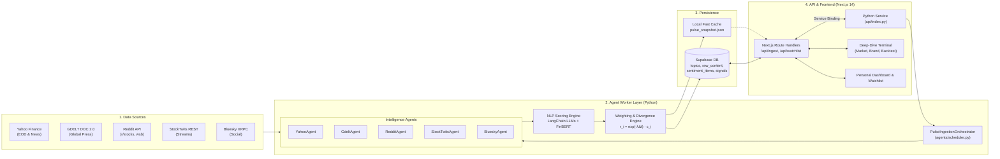
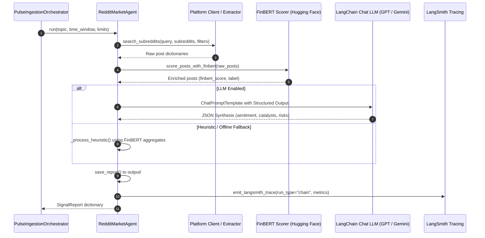
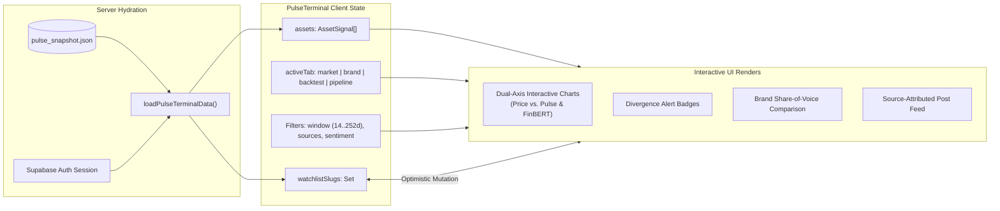

# ⚡ PULSE
### Real-Time Sentiment & Analytical Market Signal Platform

Multi-Agent AI & FinBERT Intelligence Architecture

  
    SYSTEM ARCHITECTURE & TECHNICAL DEEP DIVE
  

<!--
Welcome to the technical overview of Pulse. Pulse is an institutional-grade market intelligence platform engineered to bridge the gap between unstructured public opinion and quantifiable market price action. Over the next slides, we cover the problem, system architecture, agent loop, data pipeline, and direct walkthroughs of the live terminal UI.
-->

---
transition: fade-out
---

# 1. Problem & Value Proposition

### The Challenge: Information Noise & Latency in Public Discourse

- **Fragmented Discourse**: Market sentiment is fractured across newsfeeds, social platforms, and specialized trading forums.
- **Cognitive Bias & Lag**: Manual diligence suffers from availability bias and cannot scale to multi-asset scanning.
- **Financial Slang Misclassification**: Generic LLMs struggle with domain phrases ("bear trap", "short squeeze", "bag holding").
- **Unverified Noise**: Unattributed social commentary lacks rigorous ground-truth validation and source tracing.

<!--
Retail investors, analysts, and brand PR teams face hundreds of thousands of daily posts and articles. Reading these manually introduces significant latency and severe cognitive bias based on whichever headlines appear first. Furthermore, standard language models frequently misunderstand financial vernacular, mistaking negative colloquial terms for positive sentiment or failing to detect sarcasm and technical market jargon.
-->

---
transition: slide-left
---

# High-Level Value Proposition

### What Pulse Delivers

- **Continuous 5-Channel Ingestion**: Aggregates Yahoo Finance, GDELT 2.0, Reddit, StockTwits, and Bluesky.
- **Calibrated Pulse Index (-100 to +100)**: Time-decayed, credibility-weighted multi-source sentiment synthesis.
- **Dual-Engine NLP Validation**: High-level LLM reasoning benchmarked against domain-tuned Hugging Face FinBERT.
- **Actionable Divergence Signals**: Automatic detection when asset price action decouples from underlying social sentiment.

<!--
Pulse transforms chaotic public streams into quantifiable signals. We provide a single calibrated index from minus one hundred to plus one hundred, backed by an exponential time-decay function and source credibility weights. By pairing LLM reasoning with an on-device FinBERT classifier, we maintain higher than seventy-six percent benchmark agreement and flag price-sentiment divergences in real time.
-->

---
transition: slide-left
layout: two-cols
---

# UI Walkthrough: Market Overview

### Real-Time Macro Heatmap (`/`)

- **Live Ticker Ribbon**: Continuous prices & Pulse scores across 14 assets (NVDA, AAPL, MSFT, BTC, Gold).
- **Macro KPI Scorecard**: Composite Index (+13.0), 11 Divergences (⚡), 252 Verified Citations, 420 synced bars.
- **14-Asset Heatmap Matrix**: Tech equities, commodities (GC=F), crypto (BTC), and brand rivals (NKE vs ADDYY).
- **Conviction & Divergence Radars**: Top Bullish leaders, Contrarian watch, and 1-click terminal inspection links.

::right::

  

<!--
Here is the live Market Overview homepage. At the very top, the ticker tape streams real-time prices and sentiment scores. Below that, the KPI cards summarize composite market sentiment (+13.0), active 5-day divergence signals (11), verified FinBERT citations (252), and historical OHLCV depth (420 bars). The 14-asset heatmap allows one-click access into any stock, commodity, or brand.
-->

---
transition: slide-left
class: full-diagram
---

<h2>2. End-to-End System Architecture</h2>

<!--
This flowchart depicts the entire Pulse ecosystem arranged horizontally from left to right. The external sources feed into our Python agent worker layer. The orchestrator invokes individual market agents, runs dual-model NLP scoring, computes weighted aggregations, and persists results to Supabase PostgreSQL and a local snapshot cache. The frontend communicates with Next.js route handlers, which bind to the Python orchestrator for live trigger runs.
-->

---
transition: slide-left
---

# Architecture Breakdown: Decoupled Layers

### Ingestion, Persistence, and Presentation

- **Autonomous Agent Fleet**: Specialized modular workers handle authentication, rate limits, and fallback mock data.
- **Deterministic Scoring Core**: Decoupled NLP pipeline combines generative LLMs with local PyTorch FinBERT embeddings.
- **Relational Persistence**: PostgreSQL with Row-Level Security, tracking raw posts, sentiment items, daily signals, and OHLCV bars.
- **Dual Runtime Deployment**: Next.js Node.js serverless runtime connected to a Python serverless microservice via Vercel Service Bindings.

<!--
Notice how the architecture separates data gathering from analytical evaluation. The agent workers don't just dump raw text into the database; they normalize content into unified Pydantic schemas, execute local FinBERT inference, compute recency decay weights, and package clean JSON payloads for both Supabase storage and direct frontend consumption.
-->

---
transition: slide-left
class: full-diagram
---

<h2>3. Agent Architecture & Execution Loop</h2>

<!--
This sequence diagram illustrates the internal lifecycle of each agent execution. First, the orchestrator triggers the agent. The agent invokes its dedicated client or extractor with rate-limiting and deduplication. Posts are scored via FinBERT on device. Then, if API keys are configured, LangChain sends a strict JSON prompt to the LLM for high-level thematic synthesis and disambiguation; otherwise, a heuristic pipeline takes over.
-->

---
transition: slide-left
layout: two-cols
---

# UI Walkthrough: Deep Terminal

### Market Lens & Divergence Overlay (`/terminal`)

- **Dual-Axis Chart**: Overlay of stock price ($176.80) vs. Pulse Index (+8.3) and FinBERT baseline (+0.6).
- **Divergence Alerts (⚡)**: Visual yellow markers identify where price dropped (-5.27%) while sentiment rose (+8.3).
- **Agent Consensus Breakdown**: Multi-agent weighting (Yahoo 1.35x, GDELT 1.30x, Reddit 1.00x, StockTwits 0.95x, Bluesky 0.90x).
- **Source-Cited Feed**: 18 verified cards linking to original news articles and Reddit discussions with individual scores.

::right::

  

<!--
This is the Deep-Dive Terminal showing NVIDIA (NVDA). The dual-axis chart visualizes the bullish divergence: while NVDA price dropped 5.27% to $176.80, the Pulse Sentiment Index actually climbed to +8.3 with 94.2% FinBERT model agreement. Below the chart, we expose the exact weighted consensus scores across all 5 agents and provide the direct, source-cited feed of all 18 analyzed posts.
-->

---
transition: slide-left
---

# Agent Tool & Decision Architecture

### How Individual Agents Process Financial Information

- **Disambiguation Filtering**: Prompts enforce entity resolution (e.g., Apple hardware vs. fruit; Gold futures vs. game tokens).
- **Domain Baseline with FinBERT**: Runs `ProsusAI/finbert` on Apple Silicon MPS or CPU to score financial valence (-100 to +100).
- **LangSmith Tracing**: Base agent logs runs, input parameters, sentiment scores, and summaries to LangSmith observability endpoints.
- **Graceful Degradation**: Multi-tier LLM selection (`gpt-4o-mini` → `gemini-1.5-flash` → offline heuristic mode) ensures zero downtime.

<!--
BaseAgent abstracts all the complexity of LLM initialization, environment loading, and report serialization. Every worker inherits standard persistence hooks and automatic LangSmith telemetry. If external LLM APIs experience rate limiting or outages, agents fail over smoothly to FinBERT sequence classification without crashing the pipeline.
-->

---
transition: slide-left
---

# 4. Backend Data Flow & Processing Pipeline

### Continuous Ingestion, Normalization & Scoring

- **Source Credibility Weighting**: Yahoo Finance ($1.35\times$), GDELT ($1.30\times$), Reddit ($1.00\times$), StockTwits ($0.95\times$), Bluesky ($0.90\times$).
- **Recency Decay Factor ($r_i$)**: Calculated as $r_i = e^{-\lambda \Delta t}$, penalizing older articles over a 7-day rolling window.
- **Pulse Sentiment Index**: Weighted harmonic index combining individual post weights and agent aggregate signals.
- **Divergence Engine**: Identifies bullish (price down, sentiment surging) and bearish (price up, sentiment collapsing) market anomalies.

<!--
Our aggregation algorithm in scheduler.py guarantees that institutional reporting from Yahoo Finance and GDELT carries more weight than anonymous forum chatter, while still incorporating real-time retail momentum. The exponential decay parameter lambda ensures that news from three hours ago influences the Pulse Index significantly more than news from five days ago.
-->

---
transition: slide-left
layout: two-cols
---

# UI Walkthrough: Auth & Security

### Supabase Row-Level Security (`/login`)

- **Secure Authentication**: Built on Supabase Auth with encrypted HTTP-only session cookies and PKCE auth flow.
- **Row-Level Security (RLS)**: Enforces private watchlists, custom thesis notes, and portfolio alerts per user ID.
- **Unified Auth Portal**: Single-click toggle between existing account sign-in and instant account creation.
- **Graceful Offline Mode**: Unauthenticated users retain public read-only access to macro signals and terminal charts.

::right::

  

<!--
The authentication view handles secure user access. Powered by Supabase Auth and Row-Level Security, user data—such as custom watchlists and personal analytical notes—is strictly isolated at the PostgreSQL database level. Unauthenticated guests can still explore public market signals, but logging in unlocks customized portfolio tracking.
-->

---
transition: slide-left
---

# Key Backend Endpoints & Service Contracts

### Unified API Surface Across Next.js and Python Runtimes

- **`POST /api/ingest` (Next.js)**:
  - Invokes internal Python service (`AGENT_SERVICE_URL/ingest`) or spawns `scheduler.py` locally.
  - Updates Supabase `scheduled_ingestion_runs` table and returns refreshed JSON snapshot.
- **`GET /api/ingest` (Next.js)**:
  - Returns the latest 15 pipeline execution logs and snapshot status.
- **`GET /api/watchlist` & `POST /api/watchlist`**:
  - Handles authenticated user watchlist toggles, symbol additions, and custom investment thesis notes.
- **`POST /ingest` & `GET /health` (Python Service `api/index.py`)**:
  - Low-level Vercel Python runtime entry point directly executing `PulseIngestionOrchestrator`.

<!--
The backend employs a hybrid architecture. The Next.js API routes provide the primary gateway for the frontend, taking care of Supabase session authentication and authorization. For heavyweight multi-agent execution, Next.js calls out to the Python runtime endpoint or executes the Python script directly, updating the shared Postgres database.
-->

---
transition: slide-left
---

# 5. Frontend Architecture & State Management

### Next.js 14 App Router with Hybrid Server/Client Components

- **Server-Side Data Hydration (`loadPulseData.ts`)**:
  - Pre-renders landing and terminal routes using Supabase Server Client and local fast-cache snapshots.
- **Modular Tabbed Architecture (`PulseTerminal.tsx`)**:
  - **Market Lens**: Dual-axis price vs. Pulse Index trend charts with divergence flags and timeframe toggles (14d/30d/90d/252d).
  - **Brand Lens**: Comparative share-of-voice volume, sentiment differentials, praise catalysts, and customer complaints.
  - **Backtesting Module**: Statistical next-day price correlation and predictive accuracy percentages across 12 months.
  - **Social Radar & Pipeline Ops**: Live influencer tracking and manual ingestion pipeline trigger consoles.

<!--
The frontend is engineered with Next.js 14 App Router. Rather than forcing clients to fetch massive historical datasets on mount, loadPulseData pre-hydrates initial server components with historical OHLCV data, signals, and watchlist state. The client then takes over inside PulseTerminal for ultra-responsive tab switching and filtering.
-->

---
transition: slide-left
class: full-diagram
---

<h2>Frontend State & Interactive Flow</h2>

<!--
This diagram demonstrates state flow in the browser. Initial data is server-rendered from Supabase and the snapshot cache into the root component. Client state in PulseTerminal manages active tabs, date window zooming, source filters, and interactive crosshair hover indexes. Watchlist updates use optimistic UI updates backed by POST requests to /api/watchlist.
-->

---
layout: end
class: text-center
---

# ⚡ PULSE
### Analytical Market Signals Grounded in Verified Data

**Ready for Deployment & Evaluation**

  Built with Next.js, LangChain, FinBERT, Supabase & Python

<!--
In conclusion, Pulse delivers a full-stack, modular architecture that bridges high-frequency unstructured social sentiment with rigorous price analysis. The decoupled agents, dual-model NLP engine, and responsive Next.js frontend provide a robust foundation for market intelligence. Thank you.
-->
